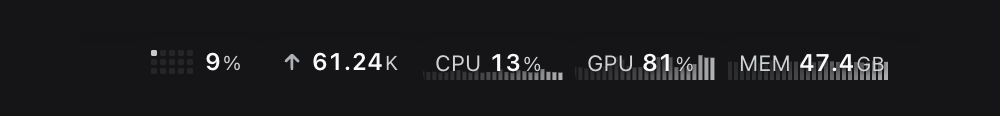
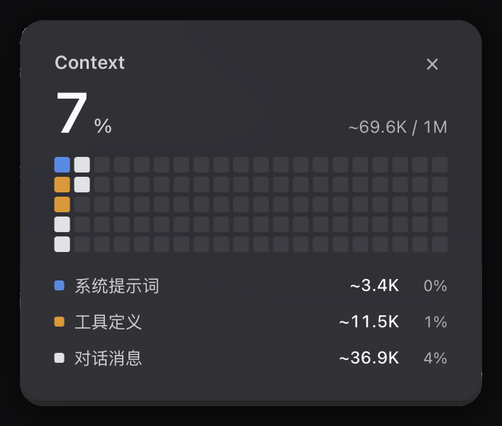
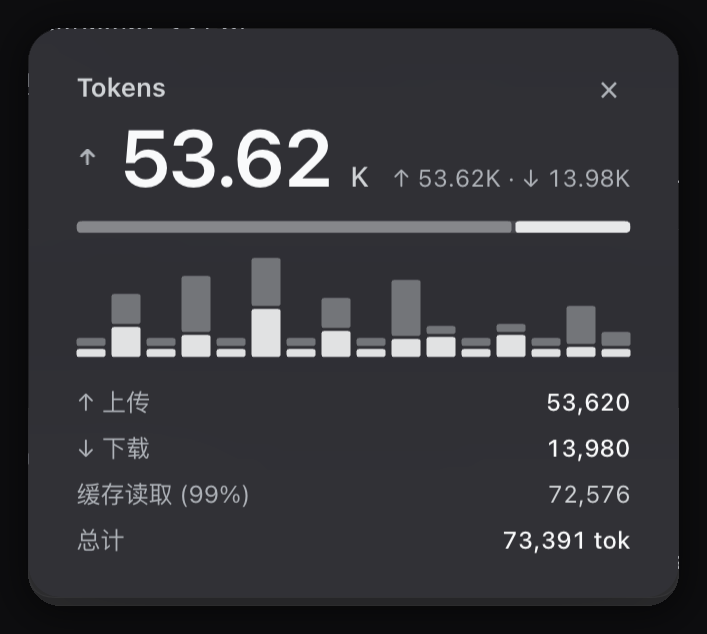
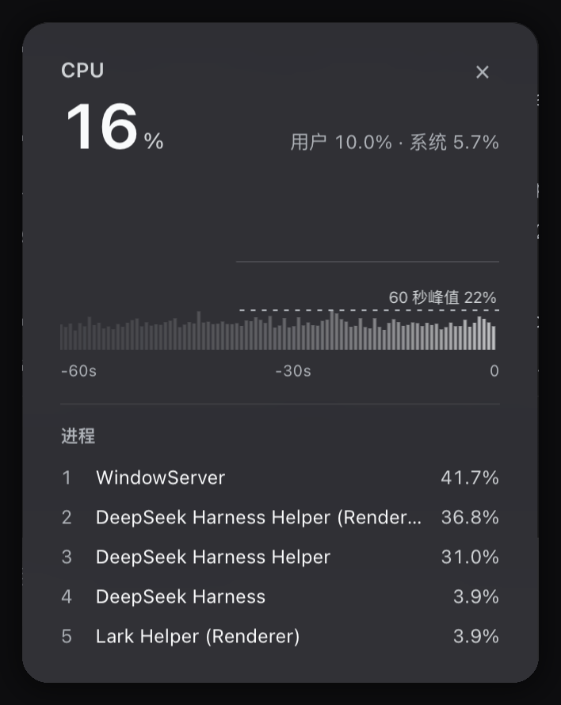
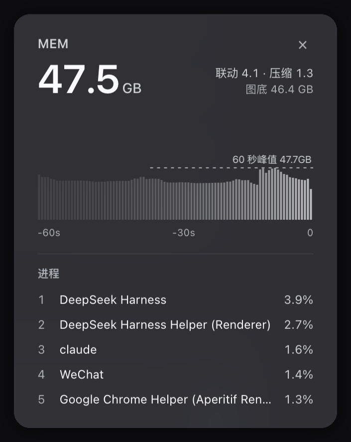
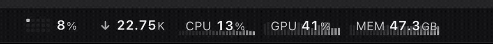

# System & Session Monitor

Five pills in the DeepSeek Harness composer dock. Context, tokens, and live system readings share one row. Click any pill to open its card.

[](LICENSE)
[]()
[]()

English · [中文](README.zh-CN.md)



## The five pills

| Pill | Live reading | Card |
| --- | --- | --- |
| Context | 5x3 micro grid and usage percentage | 20x5 brick matrix, system prompt / tool defs / messages split, cache hit rate |
| Tokens | Net upload and download per turn | Direction arrows, up/down ratio, up to 16 step bars, cache hit rate |
| CPU | User plus system load, with a 36 s bar chart | 60 s bar chart with peak line, user and system detail, top 5 processes |
| GPU | Device utilization, with a 36 s bar chart | 60 s bar chart with peak line, renderer and tiler detail, top 5 processes |
| MEM | Used and total, with a 36 s bar chart | 60 s bar chart with peak line, wired / compressed / floor rows, top 5 processes |

Drag any pill to reorder. The order persists in localStorage.

## Cards

<p align="center">
  
  
  
  
</p>

<p align="center">
  
</p>

One card opens at a time. Click anywhere outside to dismiss.

## Install

```bash
dsh plugin --profile web add github:Shiro-umi/dsh-system-monitor
```

Or install the release tarball:

```bash
dsh plugin --profile web add https://github.com/Shiro-umi/dsh-system-monitor/releases/latest/download/dsh-system-monitor.tgz
```

Link a local checkout while developing:

```bash
dsh plugin --profile web add link:/path/to/dsh-system-monitor
```

Restart DeepSeek Harness afterward.

Requires macOS and clang (Xcode Command Line Tools). On first start the plugin compiles `sampler.c` into `bin/sampler`. When the install directory is read-only it builds into the system temp directory instead.

## Sampling

| Item | Value |
| --- | --- |
| Rate | One frame every 200 ms |
| CPU | Per-core tick deltas, split into user and system |
| GPU | IOAccelerator PerformanceStatistics |
| Memory | vm_statistics64, same basis as `top` PhysMem |
| Transport | NDJSON stream from the host |
| Idle stop | Sampler exits 5 s after the last subscriber leaves |
| Orphan guard | Sampler exits when the parent process is gone |

## Fallbacks

| Condition | Behavior |
| --- | --- |
| clang missing | Frames built from `top`, `ioreg`, and `sysctl` once per second, LOW tag on the pill |
| Not macOS | Native sampler off, falls back to CPU and memory from node:os |
| Process query fails | Card shows a placeholder, metrics keep updating |

## Slots

The plugin takes three entries in the composer dock. It replaces the built-in usage and activity indicators with its own five pills.

## Develop

```bash
npm run check
npm test
```

`npm test` verifies the manifest, export map, client static invariants, card width math, and icon geometry.

## License

MIT
