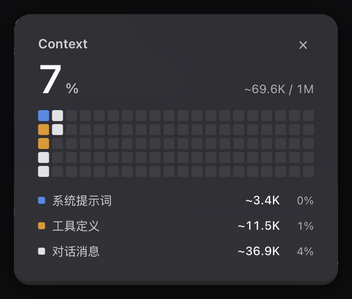
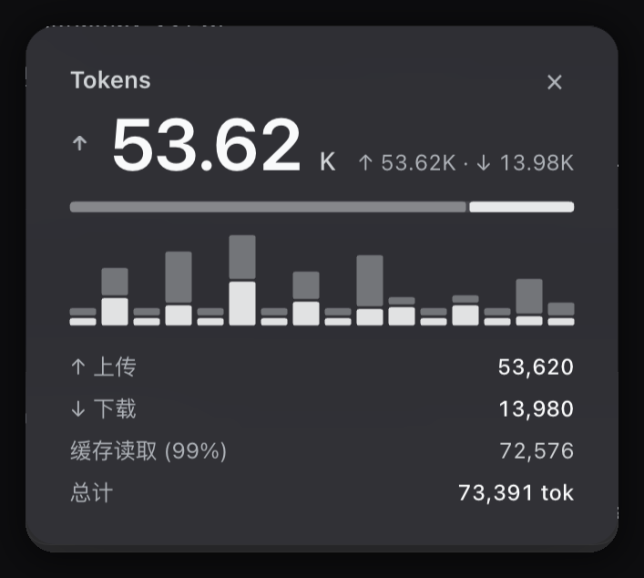
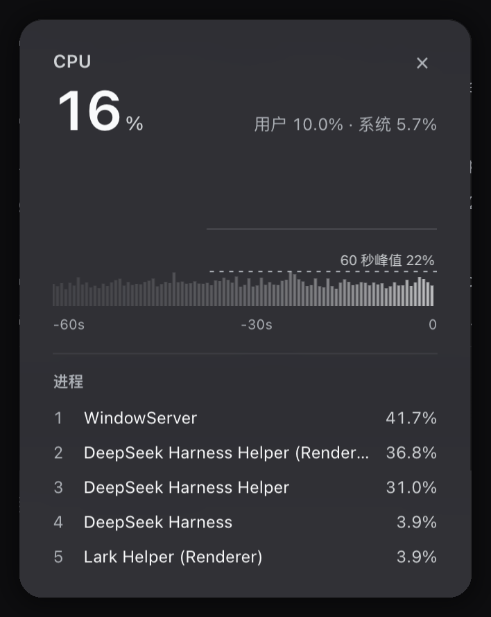
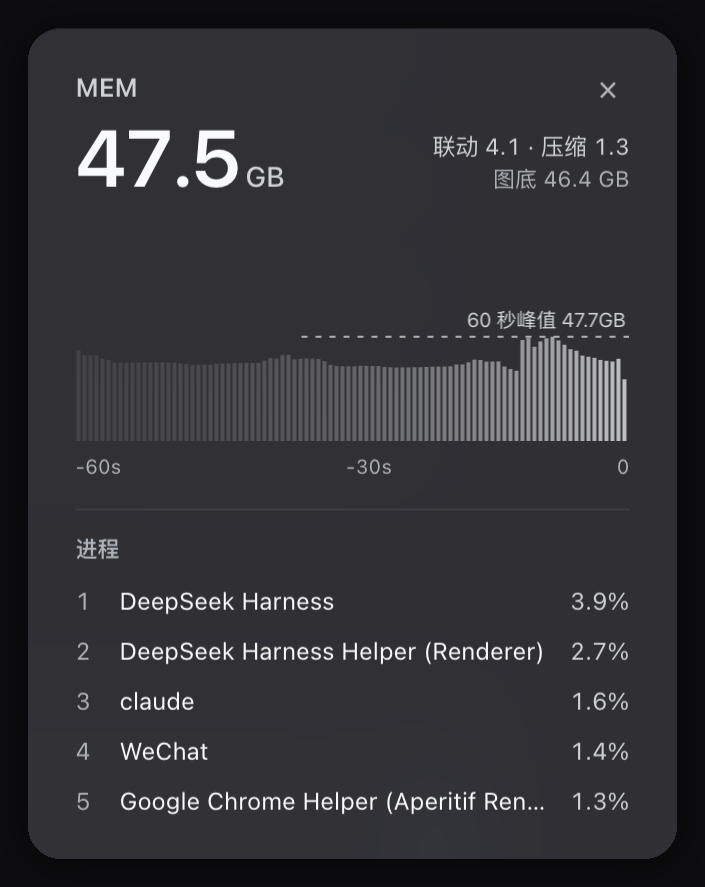

# 系统与会话监视

DeepSeek Harness 输入框底栏的五枚胶囊。Context、Tokens 和系统三项读数并排一行，点开是详情卡片。

[](LICENSE)
[]()
[]()

[English](README.md) · 中文


## 五枚胶囊

| 胶囊 | 实时读数 | 卡片内容 |
| --- | --- | --- |
| Context | 5×3 微网格与占用百分比 | 20×5 方块矩阵，系统提示、工具定义、消息三段占比，缓存命中率 |
| Tokens | 单轮净上传与下载 | 方向箭头、上下行比值、最多 16 步明细、缓存命中率 |
| CPU | 用户加系统占用，带 36 秒柱状图 | 60 秒柱状图与峰值线，user、system 明细，前 5 个进程 |
| GPU | 设备利用率，带 36 秒柱状图 | 60 秒柱状图与峰值线，renderer、tiler 明细，前 5 个进程 |
| MEM | 已用与总量，带 36 秒柱状图 | 60 秒柱状图与峰值线，联动、压缩、图底三行，前 5 个进程 |

胶囊可以拖动换序，顺序记在 localStorage。

## 详情卡片

<p align="center">
  
  
  
  
</p>

<p align="center">
  
</p>

同一时刻只展开一张，点外部区域收起。

## 安装

```bash
dsh plugin --profile web add github:Shiro-umi/dsh-system-monitor
```

或装发布包：

```bash
dsh plugin --profile web add https://github.com/Shiro-umi/dsh-system-monitor/releases/latest/download/dsh-system-monitor.tgz
```

本地开发用 link：

```bash
dsh plugin --profile web add link:/path/to/dsh-system-monitor
```

重启 DeepSeek Harness 生效。

依赖 macOS 与 clang（Xcode Command Line Tools）。首次启动自动把 `sampler.c` 编译到 `bin/sampler`，安装目录只读时改编译到系统临时目录。

## 采样口径

| 项 | 值 |
| --- | --- |
| 频率 | 每 200 毫秒一帧 |
| CPU | 逐核时间差，拆分 user 与 system |
| GPU | IOAccelerator 的 PerformanceStatistics |
| 内存 | vm_statistics64，口径同 `top` 的 PhysMem |
| 传输 | 宿主经 NDJSON 长流转发 |
| 停止 | 无订阅者 5 秒后采样器自退 |
| 兜底 | 父进程消失即退，不补发迟到帧 |

## 降级路径

| 情况 | 表现 |
| --- | --- |
| 缺 clang | 改用 `top`、`ioreg`、`sysctl` 拼帧，每秒一帧，胶囊旁显示 LOW |
| 非 macOS | 不启用原生采样器，退回 node:os 取 CPU 与内存 |
| 进程查询失败 | 卡片显示占位文案，指标照常刷新 |

## 覆盖的槽位

本插件占用底栏三个条目，覆盖自带的用量与活动指示，换上自己的五枚胶囊。

## 开发

```bash
npm run check
npm test
```

`npm test` 校验清单文件、导出映射、客户端静态不变量、卡片宽度算式和图标几何。

## 许可

MIT

